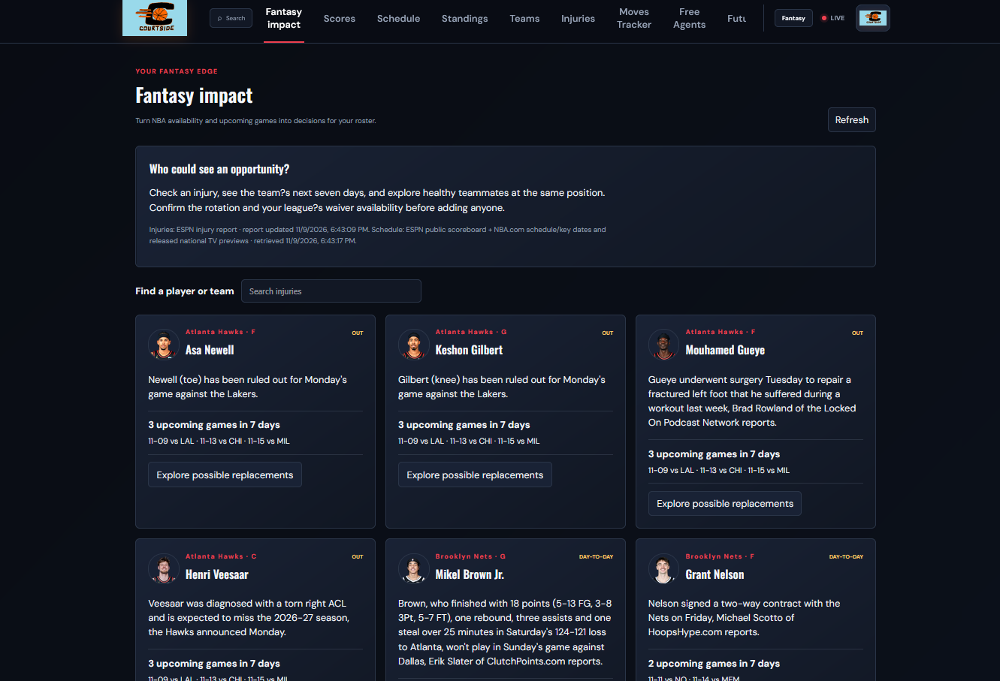
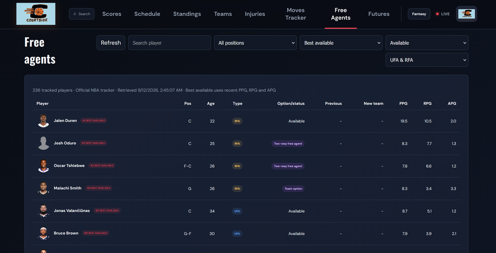
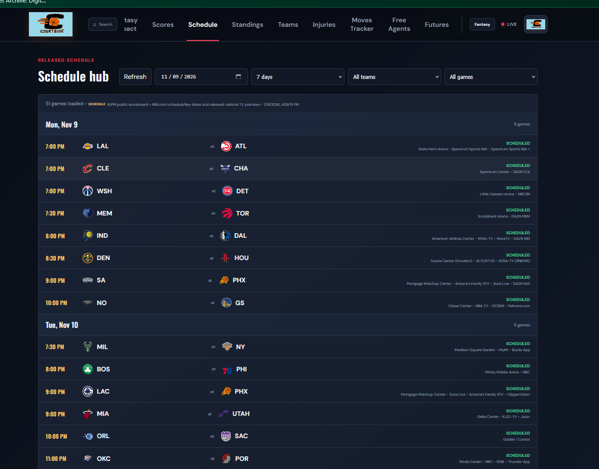
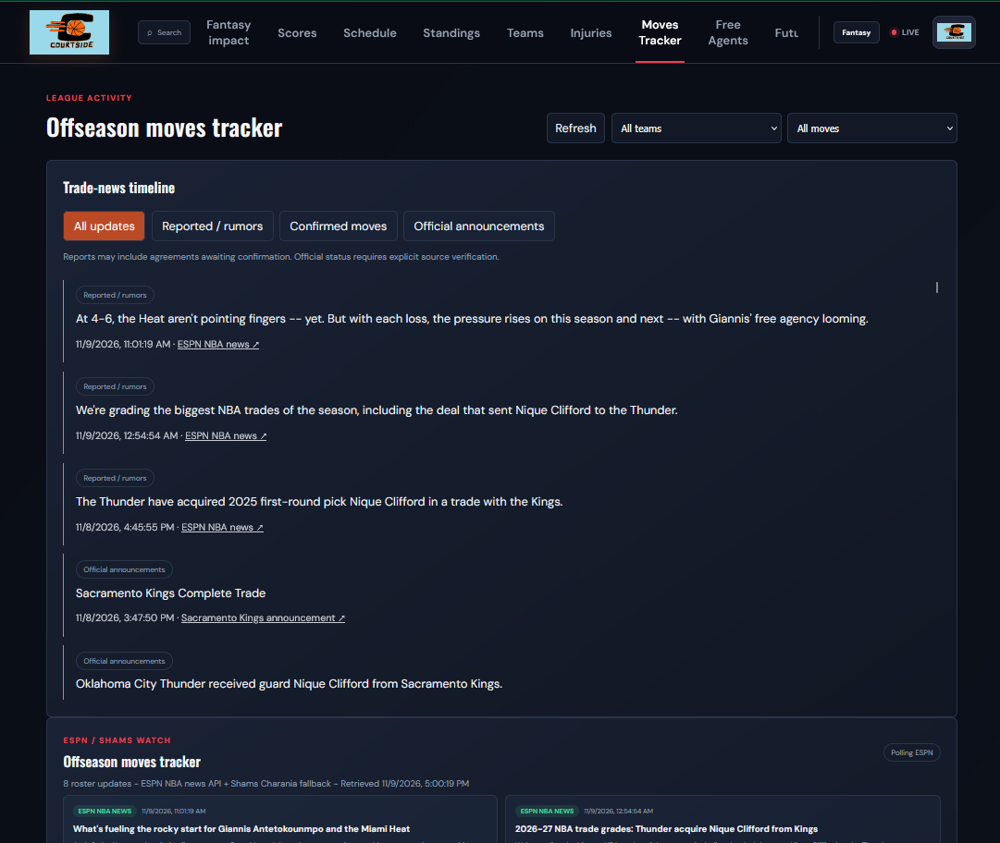
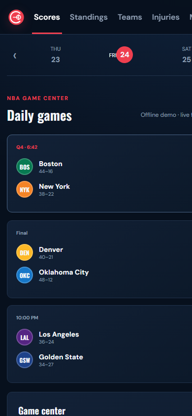

# Courtside

**NBA context for better fantasy decisions.**

Courtside brings injury reports and upcoming schedules together to help answer: *What does what is happening in the NBA mean for my fantasy team?* Explore potential replacements, manage a private fantasy league, and follow the games behind your decisions.

Built with **JavaScript, HTML, CSS, and Node.js**, with deployment support for **Vercel**.

## Fantasy impact

Start with an injury report, then check how many games that player's team has over the next seven days. Open a card to find healthy same-position teammates to investigate as possible replacements.

These are position matches, not confirmed rotation changes or waiver recommendations. Check the latest lineup, minutes, and your league's player availability before making a move. Injury and schedule source details appear on the board.



## Fantasy leagues

Create a private Courtside league, invite friends, run a timed snake draft, set daily lineups, and follow head-to-head matchups and standings. Leagues also support rolling waivers, trades, injured reserve, and playoffs. Hosted leagues require shared storage; see [fantasy setup and rules](docs/fantasy.md).

## Explore Courtside



*The free-agent tracker brings player filters, availability, and season statistics together.*

<details>
<summary>See schedule and moves tracker screenshots</summary>





</details>

- **Follow your team:** see its upcoming games, injuries, moves, and news on the home dashboard.
- **Watch the league:** follow live scores, box scores, game recaps, standings, and schedules. Pin a game to keep its score nearby.
- **Research players and moves:** browse rosters, player profiles, transactions, contracts, payrolls, and free agents.
- **Choose your alerts:** enable browser notifications for your favorite team's games and league moves while Courtside is open.

<details>
<summary>View the mobile layout</summary>



</details>

## Demo video

A demonstration video is planned. It will show the fantasy impact board, a private league, and the NBA context behind a roster decision.

## Engineering highlights

Courtside connects a browser interface to a Node.js API that normalizes data from multiple basketball sources.

- **Consistent data shapes:** provider adapters handle upstream responses so the interface can work with a common format.
- **Resilient score updates:** caching and fallback data help when feeds are unavailable. Saved scoreboard data is labeled offline, and older requests cannot overwrite a newer date selection.
- **Independent score tracking:** the pinned widget refreshes its chosen game even when you browse another scoreboard date.
- **Responsive interaction:** desktop and mobile layouts, keyboard controls, and labeled dialogs support different ways of using the app.
- **Automated checks:** tests cover provider normalization, finance invariants, HTTP validation, security headers, accessibility guardrails, score-request ordering, and bundled logos.

```text
Browser interface --> Node.js API --> Basketball data sources
                         |
                Normalization + caching
```


## Run locally

Requires Node.js 18 or newer.

```sh
git clone https://github.com/FarhnChy/Courtside-nba-stat-tracking.git
cd Courtside-nba-stat-tracking
npm install
npm run dev
```

Open [localhost:3000](http://localhost:3000).

```sh
npm test             # Run automated checks
npm run audit:data   # Check manual snapshots for stale data
```

On Windows PowerShell, use `npm.cmd` if script execution settings prevent `npm` from running.

<details>
<summary>Project structure and deployment</summary>

| Location | Purpose |
| --- | --- |
| `public/` | Browser interface, styles, pinned scoreboard, and team logos |
| `server.js` | Local server and API routes |
| `lib/` and `providers/` | Data adapters and normalization |
| `data/` | Fallback snapshots and curated roster context |
| `api/` and `vercel.json` | Vercel deployment configuration |
| `test/` | Automated checks |

To deploy, import the repository into Vercel using the **Other** framework preset. The project includes static assets and a Node Function for API requests. NBA feeds need no API key. Shared fantasy leagues require server-side storage credentials; see [fantasy deployment setup](docs/fantasy.md).

</details>

## Data and project status

Scores and league updates use ESPN public site feeds. Free-agent and cap information draws on NBA.com, NBA Communications, Basketball Reference, and SalarySwish. Repository snapshots provide additional fallback context. These integrations are unofficial, and availability or freshness can vary by source.

Courtside is moving toward fantasy decisions, supported by scores and league tracking. Prediction, shot-chart, and win-probability views are **demonstrations, not validated forecasts**. The race center shows ESPN conference standings and links to published award coverage. Fantasy runs private Courtside leagues with server-side storage and scoring; it does not sync with ESPN or Yahoo fantasy accounts. Desktop floating requires Document Picture-in-Picture support and HTTPS or localhost; the corner widget is available without that feature.

Fantasy supports private team recovery keys, timed snake drafts with manager queues, daily utility lineups, rolling waivers, one-for-one trades, injured reserve, seven-day matchups, standings, and two- or four-team playoffs. Statistical draft rankings and email account recovery remain future work. See [fantasy setup and rules](docs/fantasy.md) before inviting friends.

Background scoring and news collection run locally with the server, or on Vercel Hobby through the included GitHub Actions schedule after configuration. Follow the [Hobby database and background setup](docs/background-updates.md). The transaction tracker includes official NBA moves and announcements from all 30 teams; see [coverage and limits](docs/moves-tracker.md).

Next steps include hosted two-manager validation, account recovery, richer trade packages, verified minutes and role changes, a lineup-system simulator, and backtested prediction models.

---

Courtside is an independent portfolio project, not affiliated with or endorsed by ESPN or the NBA. Team names and logos belong to their respective owners.
